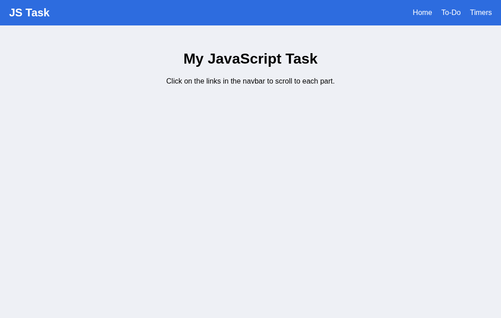
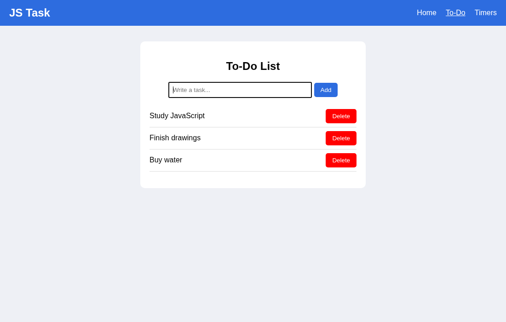
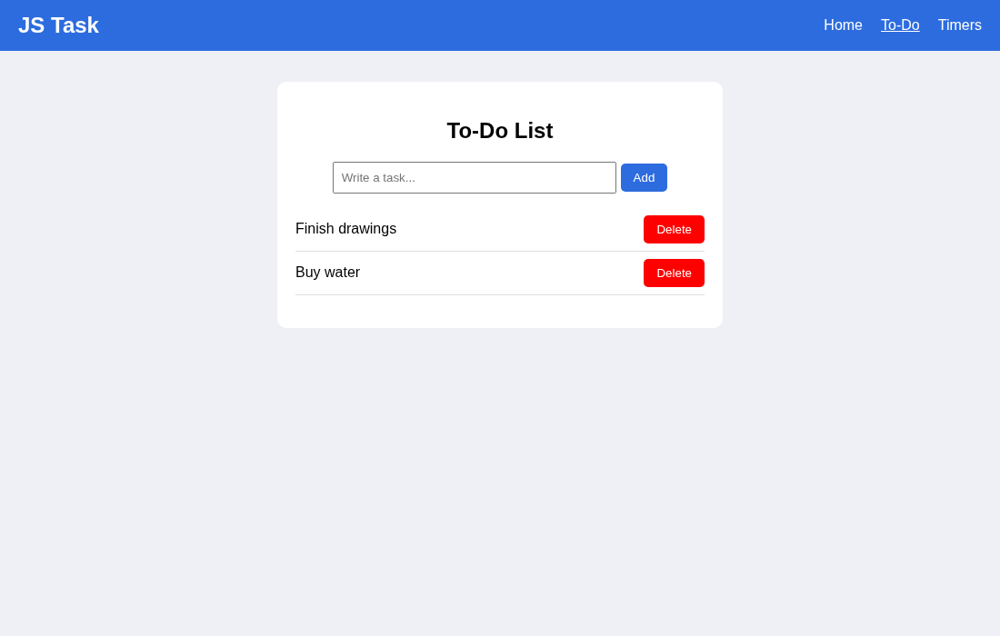
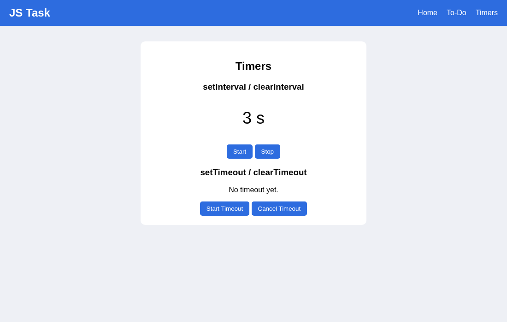
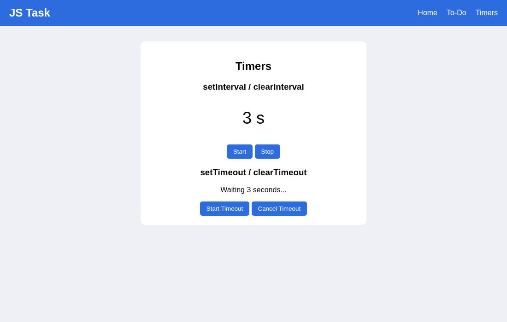
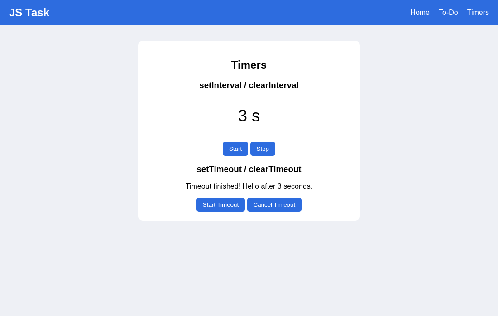
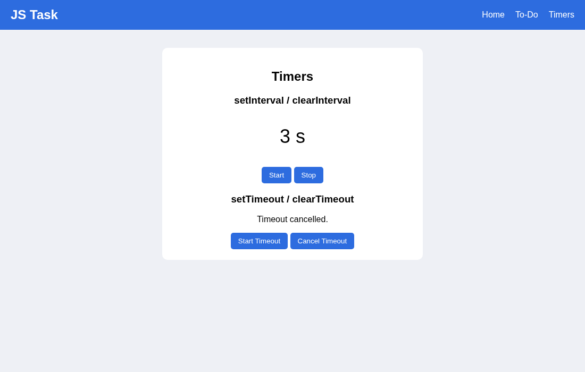

# JavaScript Task 1

This is my first JavaScript task (HTML, CSS and plain JavaScript, no libraries).

It has 3 parts:

1. **To-Do list** - add a task, delete a task with the Delete button, and the tasks are saved in localStorage so they are still there after refreshing the page.
2. **Navbar with smooth scroll** - the links in the navbar scroll smoothly to each section (done with `scroll-behavior: smooth` in the CSS).
3. **Timers** - `setInterval` / `clearInterval` (a counter with Start and Stop) and `setTimeout` / `clearTimeout` (a message after 3 seconds that can be cancelled).

## Files

- `index.html`
- `style.css`
- `script.js`

## How to run

Just open `index.html` in the browser.

## Screenshots

Navbar:

To-Do list with 3 tasks:

After deleting one task and refreshing the page (the tasks are still saved):

setInterval running:

setTimeout waiting:

setTimeout finished:

setTimeout cancelled with clearTimeout:

